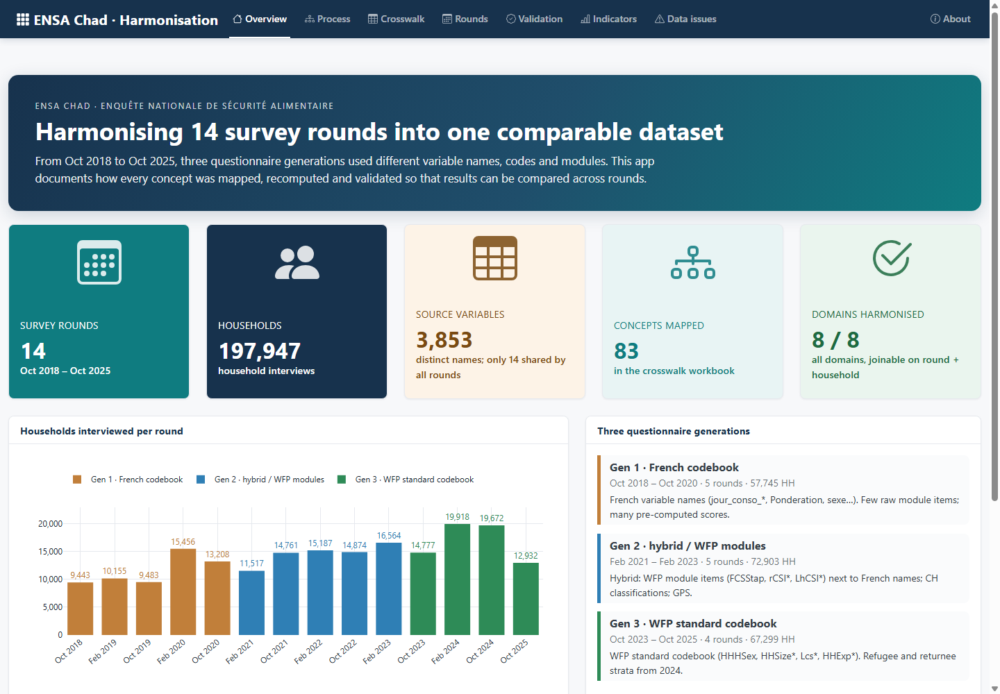
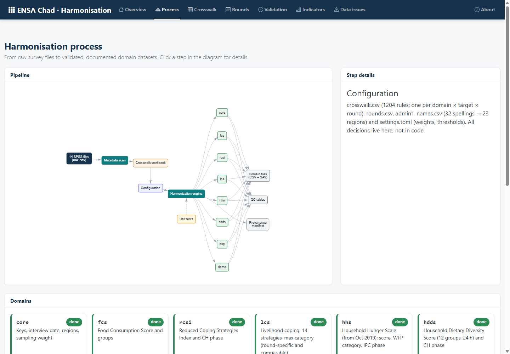
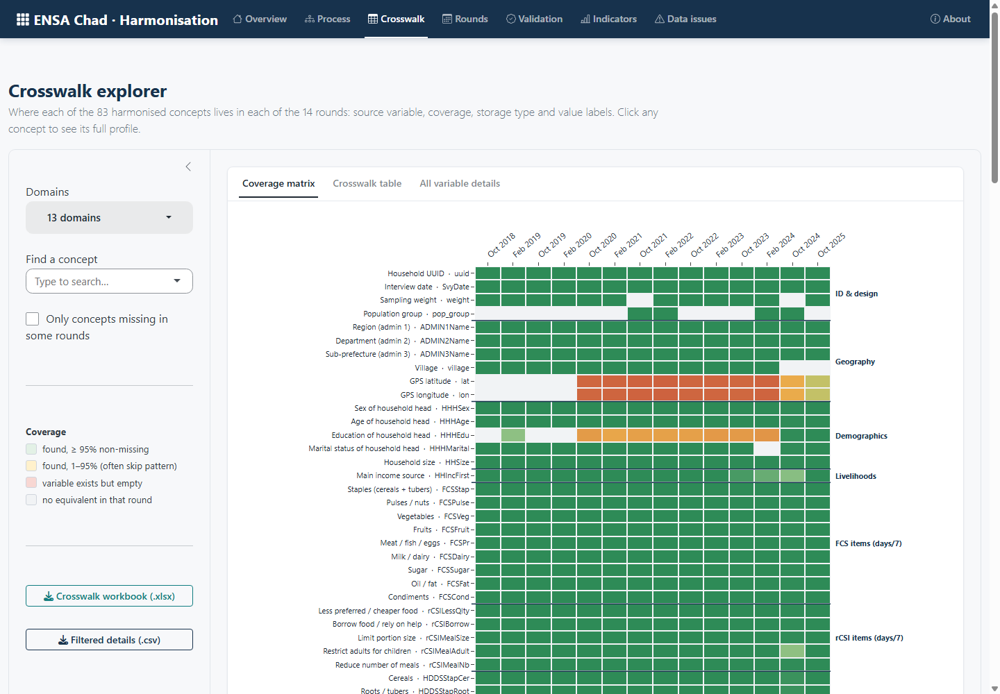
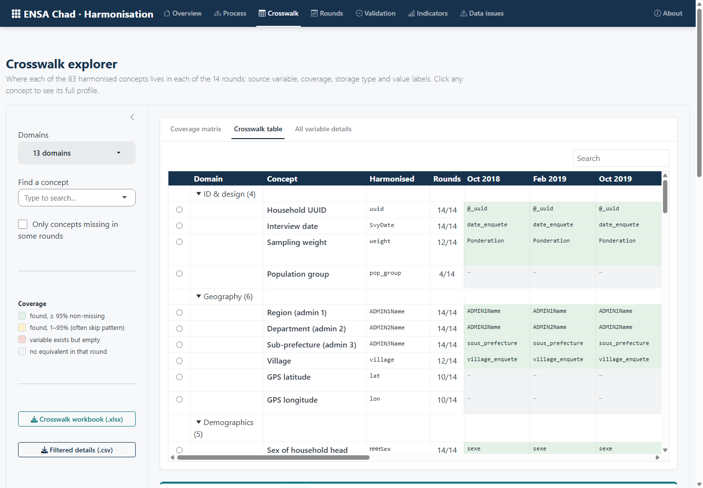
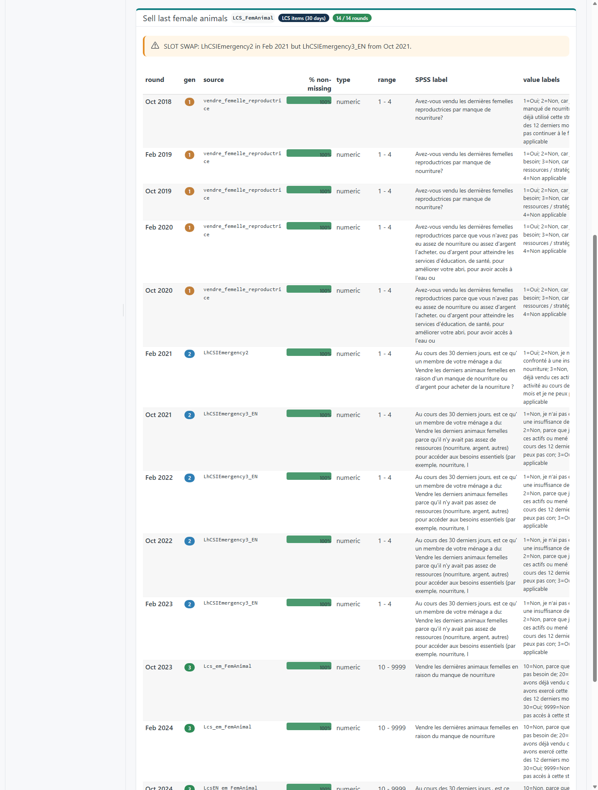
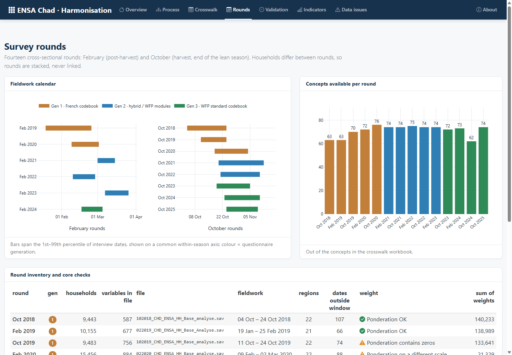
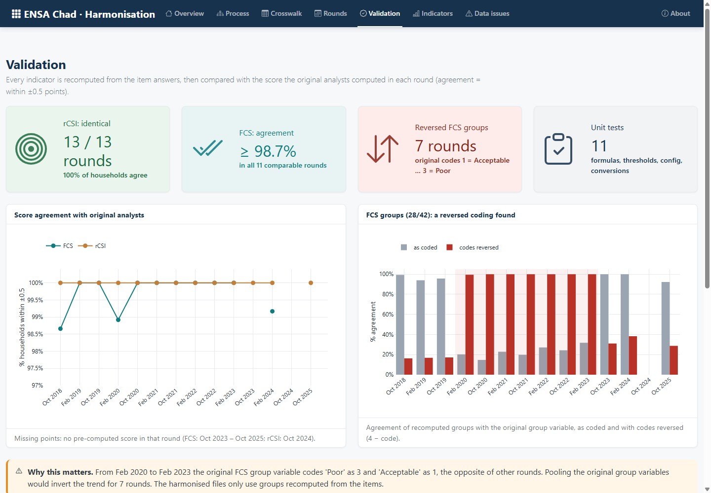
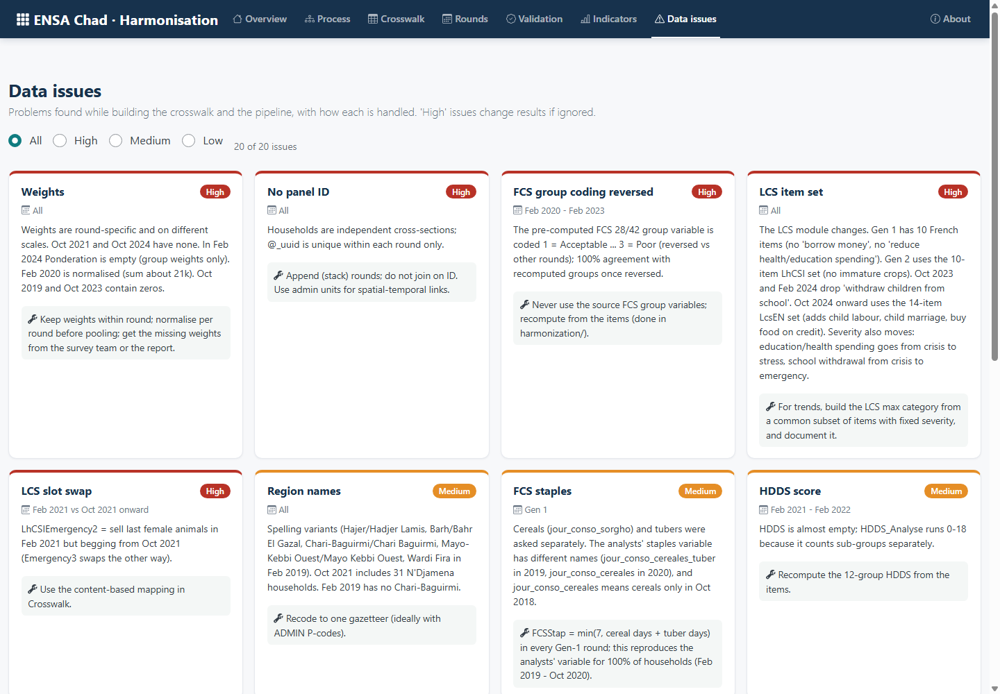

# ENSA Chad 2018–2025 — Reproducible harmonisation of household food security surveys


-276DC3?logo=r&logoColor=white)


A config-driven, tested and documented workflow that harmonises **14 rounds** of Chad's national food security assessment (*Enquête Nationale de Sécurité Alimentaire*, ENSA), October 2018 to October 2025, **197,947 households**, into one comparable dataset per **thematic domain**. It has two parts:

- a **Python pipeline** that reads the SPSS files, applies explicit mapping rules, recomputes the indicators and validates them;
- an **R Shiny explorer** that presents the process, the crosswalk and the validation to reviewers.

Across these rounds the questionnaire went through three codebook generations: French variable names (2018–2020), a hybrid with WFP modules (2021–2023) and the WFP standard codebook (2023–2025). Only 14 of 3,853 variable names, all KoBo system fields, are shared by every round. This repository turns that heterogeneity into explicit, auditable mapping rules and recomputes the indicators the same way for every round.



> **Data are not included.** The repository contains code and harmonisation rules only. See [Data](#data).

---

## Contents

- [Highlights](#highlights)
- [Domains](#domains)
- [Data](#data)
- [Software](#software)
- [Quick start](#quick-start)
- [Interactive explorer (R Shiny)](#interactive-explorer-r-shiny)
- [Repository structure](#repository-structure)
- [How harmonisation works](#how-harmonisation-works)
- [Validation](#validation)
- [Domain decisions](#domain-decisions)
- [Data issues found during harmonisation](#data-issues-found-during-harmonisation)
- [Reproducibility](#reproducibility)
- [Extending the pipeline](#extending-the-pipeline)
- [Outputs](#outputs)
- [Author, citation and license](#author-citation-and-license)

---

## Highlights

- **All decisions are in configuration, not code.** Every source variable for every domain × target × round is one row of [`config/crosswalk.csv`](config/crosswalk.csv), including the variables that are explicitly unavailable, each with a reason.
- **Indicators are recomputed from the item answers** with the WFP formulas, never copied from the heterogeneous pre-computed scores.
- **Validated against the original analysts' scores:** rCSI is identical in 100% of households in all 13 comparable rounds; FCS is identical in 9 rounds and agrees for 98.7–99.2% of households in the other 3.
- **It fails loudly:** the run stops on incomplete rules, unknown region spellings or duplicate household IDs. Out-of-range answers are set to missing and counted, never clipped silently.
- **Provenance:** each run writes a manifest with SHA-256 hashes of the inputs, config and outputs, plus the software versions. Two consecutive runs give byte-identical CSV outputs.
- **Outputs in CSV and SPSS** (`.sav` with variable and value labels).

## Domains

| Domain | Status | Content |
|---|---|---|
| `core` | ✅ done | Household keys, interview date, regions (23 standardised names), department, sub-prefecture, sampling weight |
| `fcs` | ✅ done | 9 food groups, Food Consumption Score, groups 21/35 and 28/42 |
| `rcsi` | ✅ done | 5 coping strategies, reduced Coping Strategies Index, Cadre Harmonisé phase |
| `lcs` | ✅ done | 14 livelihood coping strategies on the WFP answer scale; maximum coping category, round-specific and comparable across rounds |
| `hhs` | ✅ done | Household Hunger Scale (from Oct 2019): 3 questions and frequencies, score 0–6, WFP category, IPC / CH phase |
| `hdds` | ✅ done | 12 food groups eaten in the past 24 hours, Household Dietary Diversity Score, Cadre Harmonisé phase |
| `exp` | 🔜 planned | Food / non-food expenditure, food expenditure share |
| `demo` | 🔜 planned | Head of household characteristics, household size, income source |

The variable mapping for the planned domains has already been worked out (crosswalk workbook, 83 concepts × 14 rounds); they need their rules and a domain module.

## Data

The ENSA household surveys are conducted by the Government of Chad (SISAAP) with WFP and partners. The microdata are **not redistributed here**. Request access from the data owners.

The pipeline expects the original SPSS files laid out like this (folder names are configurable in [`config/rounds.csv`](config/rounds.csv) and [`config/settings.toml`](config/settings.toml)):

```
<data folder>/
├── Round  de fevrier/      022019 … 022024_CHD_ENSA_HH_Base_analyse.sav   (6 rounds)
├── Round d'octobre/        102018 … 102025_CHD_ENSA_HH_Base_analyse.sav   (8 rounds)
└── harmonization/          <- this repository
```

| Round | Households | Generation | | Round | Households | Generation |
|---|---:|:---:|---|---|---:|:---:|
| Oct 2018 | 9,443 | 1 | | Oct 2021 | 14,761 | 2 |
| Feb 2019 | 10,155 | 1 | | Feb 2022 | 15,187 | 2 |
| Oct 2019 | 9,483 | 1 | | Oct 2022 | 14,874 | 2 |
| Feb 2020 | 15,456 | 1 | | Feb 2023 | 16,564 | 2 |
| Oct 2020 | 13,208 | 1 | | Oct 2023 | 14,777 | 3 |
| Feb 2021 | 11,517 | 2 | | Feb 2024 | 19,918 | 3 |
| | | | | Oct 2024 | 19,672 | 3 |
| | | | | Oct 2025 | 12,932 | 3 |

## Software

| Part | Language | Role | Environment | Entry point | Tests |
|---|---|---|---|---|---|
| Harmonisation pipeline | **Python 3.11** | read SPSS files, apply rules, recompute and validate indicators, write CSV / SAV | [`environment.yml`](environment.yml) (conda-forge, pinned) or [`requirements.txt`](requirements.txt) | `run_harmonize.py` | `python -m pytest -q` (23) |
| Harmonisation explorer | **R ≥ 4.3** (tested 4.5.2) | Shiny app for reviewers: process, crosswalk, validation, indicators | packages installed by [`app/install_packages.R`](app/install_packages.R) | `app/app.R`, `app/run_app.bat` | `Rscript tests/test_app.R` (85) |
| App data preparation | **R** | aggregates the pipeline outputs for the app (no household data) | `data.table`, `jsonlite` | `app/prepare_app_data.R` | — |
| Analysis by domain | **R Markdown** | merges the domain files; survey-weighted tables and figures; Word report | officedown, flextable, survey, ggplot2 (+ Pandoc) | `analysis/render_report.R`, `analysis/render_report.bat` | — |

**Python packages** (pinned): pandas 2.2.2, numpy 2.2.6, pyreadstat 1.2.7, pytest 8.2.2.

**R packages** (versions tested with R 4.5.2): shiny 1.14.0, bslib 0.11.0, bsicons 0.1.2, plotly 4.12.0, reactable 0.4.5, visNetwork 2.1.4, shinyWidgets 0.9.1, readxl 1.4.5, readr 2.1.6, dplyr 1.2.1, tidyr 1.3.2, jsonlite 2.0.0, plus data.table 1.18.0 for data preparation.

Editors: VS Code (Python and R extensions; workspace settings in [`.vscode/`](.vscode/)), RStudio or Positron for the app.

## Quick start

Full step-by-step guide for Windows, Miniforge and VS Code: **[SETUP.md](SETUP.md)**.

### 1. Harmonise the data (Python)

```bash
git clone https://github.com/Abson-dev/ensa-chad-harmonization.git harmonization
cd harmonization
conda env create -f environment.yml      # Python 3.11 + pinned packages from conda-forge
conda activate ensa-chad
python -m pytest -q                      # 23 rule tests
python run_harmonize.py                  # all domains, all rounds (about 2-3 min)
```

Useful options:

```bash
python run_harmonize.py --domains fcs                      # core + FCS only
python run_harmonize.py --rounds 2024-10 2025-10 --no-hash # quick partial run
python run_harmonize.py --formats csv                      # skip .sav output
```

### 2. Explore the results (R)

Install R from [CRAN](https://cran.r-project.org/) (RStudio is optional), then:

```bash
cd app
Rscript install_packages.R       # installs missing R packages (once)
Rscript prepare_app_data.R       # aggregates ../output into app/data (cells < 30 households suppressed)
Rscript tests/test_app.R         # 85 server-side checks of every page
Rscript -e "shiny::runApp()"     # opens the app; on Windows you can double-click run_app.bat
```

### 3. Write the analysis report (R Markdown → Word)

```bash
cd analysis
Rscript render_report.R          # Word report + CSV tables + PNG figures in analysis/output; or double-click render_report.bat
```

The report covers each domain (sample, food consumption, coping, and the two combined) with survey-weighted estimates and 95% confidence intervals; see [analysis/README.md](analysis/README.md).

## Interactive explorer (R Shiny)

[`app/`](app/) contains a Shiny app (bslib, plotly, reactable, visNetwork) that presents the whole process for reviewers.

| Page | Content |
|---|---|
| Overview | Key figures, households per round, the three questionnaire generations, the approach |
| Process | Clickable pipeline diagram, domain status, the 336 configuration rules and their methods |
| Crosswalk | The crosswalk workbook made interactive: coverage matrix (83 concepts × 14 rounds), the table as in Excel, full variable details, a profile per concept, downloads |
| Rounds | Fieldwork calendar by season, concepts per round, weights and date checks |
| Validation | Agreement with the original analysts' scores; the reversed FCS group coding |
| Indicators | FCS groups and rCSI Cadre Harmonisé phases by round and region (weighted / unweighted) |
| Data issues | The 20 issues found, ranked by impact, with how each is handled |
| About | Method, reproducibility, run provenance, data statement |

| | |
|---|---|
|  **Process**: click a step to see what it does |  **Crosswalk**: where each concept lives in each round |
|  **Crosswalk table**: source variable per round, coloured by coverage |  **Concept profile**: here, the LCS slot swap between Feb and Oct 2021 |
|  **Rounds**: fieldwork windows, weights, checks |  **Validation**: agreement and the reversed FCS coding |
|  **Data issues**: what was found and how it is handled | |

The Indicators page is not shown here: its regional estimates are preliminary and are shared only with the data owners' agreement.

The app ships **aggregates and metadata only**. Its `data/` folder is not versioned; build it after a pipeline run with `prepare_app_data.R` (see [Quick start](#2-explore-the-results-r)). Details and sharing options (Posit Connect / shinyapps.io, zipped folder): [app/README.md](app/README.md). For a non-technical user who receives the app folder with its `data/`: [app/README_FIRST.txt](app/README_FIRST.txt).

## Repository structure

```
harmonization/
├── config/                  <- ALL harmonisation decisions
│   ├── settings.toml        paths, FCS / rCSI weights and thresholds, date tolerance
│   ├── rounds.csv           one row per round: file, season, codebook generation, fieldwork window
│   ├── crosswalk.csv        one row per domain x target x round: method + source variable(s) + note
│   ├── admin1_names.csv     every region spelling found -> standard name (32 -> 23)
│   ├── lcs_responses.csv    LCS answer codes per round -> WFP scale (three source scales, one reversed)
│   └── lcs_severity.csv     severity of each LCS strategy in each round
├── ensa_harmonize/
│   ├── config.py            loads and validates the config
│   ├── engine.py            reads only the needed columns; applies crosswalk methods
│   ├── pipeline.py          orchestration, writers, provenance manifest
│   └── domains/             one module per domain: derive() + qc()
├── tests/test_rules.py      scoring rules, thresholds, conversions, config completeness
├── app/                     R Shiny explorer
│   ├── app.R                page layout and server wiring
│   ├── R/                   one module per page + data loading, theme, helpers
│   ├── www/styles.css       visual design
│   ├── tests/test_app.R     server-side checks of every page (shiny::testServer)
│   ├── prepare_app_data.R   builds app/data from ../output (aggregates only; not versioned)
│   ├── install_packages.R   installs missing R packages
│   └── run_app.bat          double-click launcher for Windows
├── analysis/                analysis by domain: R Markdown → Word report, CSV tables, PNG figures
│   ├── analysis_by_domain.Rmd
│   ├── R/                   data loading and merging, survey estimates, report style
│   └── render_report.R      / render_report.bat (double-click)
├── docs/screenshots/        app screenshots used in this README
├── .vscode/                 interpreter, test and run/debug configuration
├── environment.yml          conda environment (conda-forge, pinned)
├── requirements.txt         pip alternative
├── run_harmonize.py         command-line entry point
├── SETUP.md                 installation and usage guide
└── output/                  generated, not versioned
```

## How harmonisation works

```
raw .sav (14 rounds) ──► crosswalk rules ──► domain derive() ──► ensa_<domain>.csv/.sav
        │                (config/*.csv)       (scores, flags)            │
        └────────────── SHA-256 ──────────► manifest.json ◄──── QC tables (qc/)
```

1. For each round, the engine reads **only** the columns that the selected domains need.
2. Each target is built by one crosswalk rule:

| Method | Meaning |
|---|---|
| `copy` | Take the source variable (text-stored numbers are converted) |
| `copy_label` | Take the SPSS value label instead of the code (admin names) |
| `sum` | Row sum of the `\|`-separated sources (missing only if all are missing) |
| `sum_cap7` | Row sum capped at 7 days |
| `any` | 1 if any source is 1, 0 if none is but one is answered (sub-groups of a food group) |
| `max_or_last` | Row maximum of all sources but the last; the last one when they are all missing (sub-group days, else main group) |
| `missing` | Explicitly not available in this round; `note` says why |

3. The domain module computes the indicators and flags, and writes a QC table that compares them with the original scores.
4. All domain files share `round_id` + `hh_id` and join one-to-one to `ensa_core`.

## Validation

Recomputed scores against the scores pre-computed by the original analysts (± 0.5 points):

| Round | FCS agreement | rCSI agreement | LCS max category (exact) |
|---|---:|---:|---:|
| Oct 2018 | 98.7% | 100% | 87.7% |
| Feb 2019 | 100% | 100% | 31.2% ¹ |
| Oct 2019 | 100% | 100% | 87.3% |
| Feb 2020 | 98.9% | 100% | 100% |
| Oct 2020 | 100% | 100% | 100% |
| Feb 2021 | 100% | 100% | 100% |
| Oct 2021 | 100% | 100% | 100% |
| Feb 2022 | 100% | 100% | 69.6% ¹ |
| Oct 2022 | 100% | 100% | 93.6% |
| Feb 2023 | 100% | 100% | 97.1% |
| Oct 2023 | no original score | 100% | 100% |
| Feb 2024 | 99.2% | 100% | 100% |
| Oct 2024 | no original score | no original score | no original |
| Oct 2025 | no original score | 100% | 68.5% ² |

LCS: the round-specific maximum category is identical to the analysts' in 6 rounds, including Oct 2021, where the answer codes are reversed, which validates the recoding. In the other rounds the analysts' variable left out one to five strategies (an undocumented choice; the lowest-agreement rounds were checked by searching every inclusion and severity combination). ¹ The original variable does not correspond to these items (best possible reconstruction 48% / 88%). ² The original counts only coping to buy food and uses the pre-2024 severities; with the food filter, agreement rises to 79%.

**HDDS:** the score is identical to the analysts' in 7 rounds and agrees for 92–98% of households in the others. In Feb 2021 – Feb 2022 the analysts' score counts the vegetable, fruit and meat sub-groups separately (0–18). The phase is identical in all three recent rounds that carry one (Oct 2023, Feb 2024, Oct 2025). In Oct 2018 – Oct 2019 the original is a "test" variable with a stricter scale (7+ groups = phase 1).

**HHS:** the recomputed score is identical to the analysts' in all 8 rounds that carry one (Oct 2019 – Feb 2023), and the phase in 8 of 9 rounds. The exception is Oct 2019, where the original phase is an analyst-"corrected" classification (`Echelle_faim_cor`) that resets some households with hunger to phase 1 (82.8% agreement).

Per-round QC tables (completeness, invalid values, weighted means and prevalences, agreement) are written to `output/qc/` on every run.

## Domain decisions

### core
- `hh_id` = `round_id` + KoBo uuid. Rounds are independent cross-sections with no panel ID, so they are **stacked**, never joined on household.
- `svy_date` is converted from SPSS seconds; dates more than 7 days outside the fieldwork window are **flagged**, not removed.
- `admin1`: 32 raw spellings map to 23 standard names. `admin2` / `admin3` keep the source labels (P-code matching is a later step).
- `weight` is kept as provided. `weight_norm` rescales it to mean 1 within each round for pooled analyses.

### fcs
- WFP weights (2, 3, 1, 1, 4, 4, 0.5, 0.5, 0). The score is missing if any group is missing. Thresholds 28/42 (Chad standard) and 21/35.
- **Generation 1 staples:** cereals and tubers were asked separately. `FCSStap = min(7, cereals + tubers)` reproduces the analysts' own staples variable in 100% of households and is applied to every Gen-1 round.
- Raw answers are used, not the analysts' `*_cor` corrected items.

### rcsi
- rCSI = LessQlty + 2×Borrow + MealSize + 3×MealAdult + MealNb (0–56). Cadre Harmonisé phase: ≤3 / 4–18 / ≥19.
- **Oct 2024 skip pattern:** "restrict adults so children can eat" was not asked in households without children. It is set to 0 for those households (1,078, flagged per household); the 185 skipped answers in households with children stay missing.

### hdds
- 12 groups (24-hour recall), all coded 0/1. In Feb 2021 – Feb 2023 vegetables, fruit and meat are split into sub-groups; they are combined with the `any` method (eaten if any sub-group was eaten). Meat (flesh and organ) is combined in every round.
- **Oct 2024 skip pattern:** a 24-hour question was asked only if the group was eaten in the past 7 days. A skipped answer is set to 0 when the matching FCS 7-day answer is 0 (sub-group days for meat, fish and eggs, else the main group: `gate_*` rules, `max_or_last` method). In the data, every skipped answer has a gate of 0; 72,090 group answers were resolved, flagged as `hdds_n_imputed`.
- HDDS = number of groups eaten (0–12), missing if any group is missing. Cadre Harmonisé phase: ≥ 5 → 1, 4 → 2, 3 → 3, 2 → 4, 0–1 → 5 (`settings.toml`).

### hhs
- Collected from Oct 2019 (12 rounds); Oct 2018 and Feb 2019 are documented as not collected.
- Occurrence 0/1 and frequency 1–3 have the same codes in every round. "No" sets the frequency to 0. Answers that contradict each other (yes without a frequency, or no with one) are not scored and are counted; there are none in the data.
- Item score: never 0, rarely or sometimes 1, often 2. HHS = sum (0–6). WFP category: little or none 0–1, moderate 2–3, severe 4–6. IPC / CH phase: 0 → 1, 1 → 2, 2–3 → 3, 4 → 4, 5–6 → 5 (all in `settings.toml`).
- **Oct 2019 exception:** 80 households have an undocumented code 2 on "no food in the house". All of them answered "often" in the follow-up, and the analysts counted them as yes. It is accepted as yes in that round only (`extra_yes_codes`), flagged per household; in any other round an undeclared code stops the run.

### lcs
- **Strategies mapped by content**, not slot name: 14 strategies, 10 per round until Feb 2024 and 14 from Oct 2024 ([`config/crosswalk.csv`](config/crosswalk.csv)).
- **Answers harmonised to the WFP scale** (10 no need, 20 already exhausted, 30 yes, 9999 not applicable) with an explicit code table per round ([`config/lcs_responses.csv`](config/lcs_responses.csv)). The source files use three scales, one of them **reversed** (Oct 2021 – Feb 2023: 1 = no need, 3 = yes).
- **Used** = yes or already exhausted (WFP rule); skipped questions count as not used.
- **Severity per strategy and round** ([`config/lcs_severity.csv`](config/lcs_severity.csv)), as each questionnaire defines it. For example, reduced education/health spending is crisis until Feb 2024 and stress from Oct 2024, and school withdrawal moves from crisis to emergency.
- Two indicators (1 none, 2 stress, 3 crisis, 4 emergency):
  - `LCS_max`: **round-specific**, all strategies asked, at that round's severity. Use it for a single round.
  - `LCS_max_common`: **comparable**, the 7 strategies asked in all 14 rounds at a fixed severity (stress: household assets, animals, savings; crisis: productive assets; emergency: house/land, last female animals, begging), coping for food only. Use it for trends.
- **Food framing:** until Feb 2024 every question asks about coping "because of a lack of food". From Oct 2024 the essential-needs module asks about coping for any need, then the reason; for `LCS_max_common`, households that did not cope to buy food are excluded (1,437 in Oct 2024, 1,359 in Oct 2025; flagged as `lcs_not_for_food`). Set `food_reason_filter = false` in `settings.toml` to turn this off.

## Data issues found during harmonisation

| Issue | Rounds | Handling |
|---|---|---|
| Pre-computed FCS groups coded in **reverse** (1 = Acceptable, 3 = Poor) | Feb 2020 – Feb 2023 | Groups recomputed; reversal detected automatically in QC |
| No usable sampling weight | Oct 2021, Feb 2024 (only group weights), Oct 2024 | Weighted QC left blank; weights to confirm with the data owners |
| Weights on a different scale (sum about 21k vs 130–240k) | Feb 2020 | `weight_norm` per round |
| LCS answer codes **reversed** (1 = no need, 3 = yes) | Oct 2021 – Feb 2023 | Explicit code table per round; validated at 100% against the original in Oct 2021 |
| LCS strategy slots renumbered, item set and severities changed | Feb 2021 onward | Content-based mapping; round-specific and comparable (common-set) indicators |
| LCS module switched to essential needs (coping for any need, then reason) | Oct 2024 onward | Comparable indicator keeps coping to buy food only |
| Analysts' LCS max category built on varying, undocumented item sets | 7 rounds | Recomputed with documented rules; differences reported in QC |
| Region name variants (Hajer/Hadjer Lamis, Wardi Fira, …) | Several | Explicit lookup table |
| Many pre-computed indicators stored as text | Gen 2 | Converted, then recomputed |

## Reproducibility

- **Deterministic:** the same inputs and config give byte-identical CSV and QC outputs (verified with SHA-256). The `.sav` outputs embed their creation time, so the CSVs are the reference outputs.
- **Provenance:** `output/manifest.json` records the run time, pipeline version, Python and package versions, and SHA-256 of every input, config file and output.
- **Pinned environments:** Python in `environment.yml` (conda-forge) and `requirements.txt`; R package versions listed in [Software](#software) and in `app/install_packages.R`.
- **Tests:** `python -m pytest -q` checks the config completeness, formulas, thresholds, conversions and lookups; `Rscript app/tests/test_app.R` builds every page of the app and renders every output and filter combination.
- **No data in the app:** `prepare_app_data.R` keeps only aggregates by round and region (cells under 30 households suppressed) and strips local paths from the manifest.

## Extending the pipeline

**New round** (e.g. Feb 2026): add a row to `config/rounds.csv` and one rule per target to `config/crosswalk.csv`, then run. Validation lists any target you forgot.

**New domain**: add its rules to `config/crosswalk.csv`, write `ensa_harmonize/domains/<name>.py` (with `rcsi.py` as a template: `NAME`, `LABELS`, `VALUE_LABELS`, `derive()`, `qc()`), register it in `domains/__init__.py` and add tests.

Details: [SETUP.md §10](SETUP.md#10-change-a-harmonisation-decision).

## Outputs

| File | Rows | Columns |
|---|---|---|
| `ensa_core.csv/.sav` | 197,947 | round_id, hh_id, year, season, generation, uuid, svy_date, date_flag, admin1, admin1_raw, admin2, admin3, weight, weight_norm, weight_flag |
| `ensa_fcs.csv/.sav` | 197,947 | round_id, hh_id, 9 food groups, fcs_n_missing, fcs_n_invalid, FCS, FCSCat21, FCSCat28, orig_FCS, orig_FCSCat28 |
| `ensa_rcsi.csv/.sav` | 197,947 | round_id, hh_id, 5 strategies, rcsi_mealadult_imputed, rcsi_n_missing, rcsi_n_invalid, rCSI, rCSI_CH, orig_rCSI |
| `ensa_hdds.csv/.sav` | 197,947 | round_id, hh_id, 12 food groups, hdds_n_imputed, hdds_n_missing, hdds_n_invalid, HDDS, HDDS_phase, orig_HDDS, orig_HDDS_phase |
| `ensa_hhs.csv/.sav` | 197,947 | round_id, hh_id, 3 questions + frequencies, hhs_n_missing, hhs_inconsistent, hhs_code_exception, HHS, HHSCat, HHS_phase, orig_HHS, orig_HHS_phase |
| `ensa_lcs.csv/.sav` | 197,947 | round_id, hh_id, 14 strategies (WFP codes), lcs_n_asked, lcs_n_answered, lcs_n_used, LCS_stress, LCS_crisis, LCS_emergency, LCS_max, LCS_max_common, lcs_food_reason, lcs_not_for_food, orig_LCS |
| `qc/qc_<domain>_by_round.csv` | 14 | completeness, invalid values, unweighted and weighted indicators, agreement with original scores |

`orig_*` columns are kept for QC only; analyse the recomputed columns. Outputs contain household-level data and are **not versioned** (`.gitignore`).

## Author, citation and license

**Author:** [Abson-dev](https://github.com/Abson-dev). Built with Python (pandas, pyreadstat) and R (Shiny, bslib, plotly, reactable).

If you use this pipeline or the explorer, please cite the repository:

```
Abson-dev (2026). ENSA Chad 2018–2025 — Reproducible harmonisation of household food
security surveys. GitHub repository. https://github.com/Abson-dev/ensa-chad-harmonization
```

**License:** not yet specified. Add a `LICENSE` file before reusing the code. The license covers the code only; the ENSA data remain subject to the data owners' terms.

**Acknowledgements:** the ENSA surveys are produced by the Government of Chad (SISAAP) with WFP and partners; all credit for data collection goes to them.
